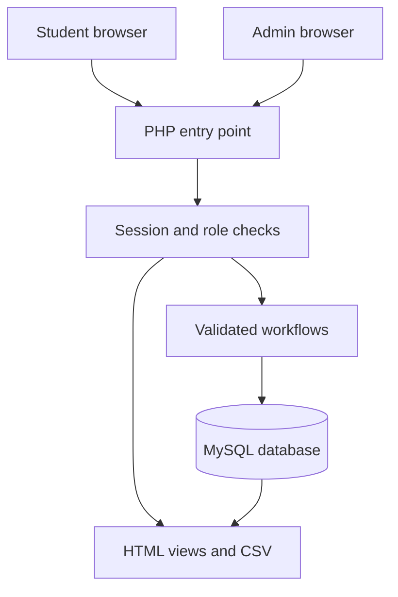
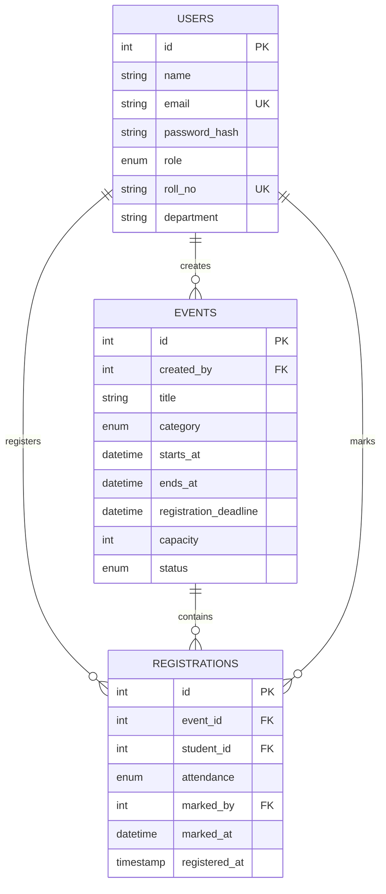
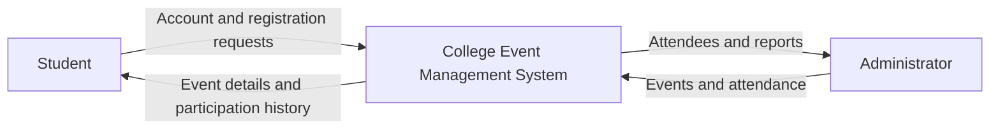
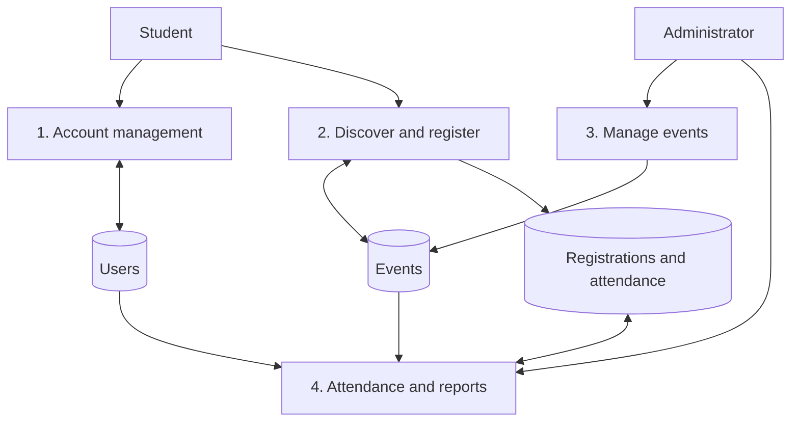

# Architecture and capstone explanation

## Request flow

The browser requests `public/index.php?page=...`. PHP initializes a session, checks the signed-in role, processes validated POST actions, queries MySQL through PDO, and renders HTML. CSS handles responsive layout; JavaScript adds confirmation and print actions. No separate API service is required.

## Entity relationships

`USERS` stores both admins and students; the role determines permitted operations. Each student/event pair is unique in `REGISTRATIONS`. Attendance is an attribute of the registration, so there cannot be an attendance record without a registration. `LOGIN_ATTEMPTS` is an additional security table keyed by email; it is independent of users so unknown email attempts can also be throttled.

## DFD level 0

## DFD level 1

## Business rules

- Self-signup always creates a student. Only pre-existing admins can manage events.
- Public discovery shows published events; upcoming/ongoing is the default filter. Past events can be included.
- Students register only before both deadline and start, while seats remain. A row lock on the event serializes registration and capacity changes; a unique constraint prevents duplicates.
- Students withdraw only before start. Withdrawal deletes that registration and releases the seat.
- Attendance is available only after a published event starts. `unmarked` is distinct from `absent`.
- Events with registrations cannot be deleted or reverted to draft; cancellation retains history.
- Reports count registrations, not unique people across all events. One student registered for three events contributes three registrations.
- Report percentage = present / registered × 100. Cancelled events remain in reports, clearly labelled.

## Suggested six-week academic plan

The dates in the pasted synopsis are not sufficiently aligned to infer their original bar positions. This is a proposed duration-based plan, not a transcription of that Gantt chart.

| Work | Week 1 | Week 2 | Week 3 | Week 4 | Week 5 | Week 6 |
|---|---|---|---|---|---|---|
| Requirements and scope | Active | | | | | |
| ER/DFD and interface design | Active | Active | | | | |
| Accounts and event management | | Active | Active | | | |
| Registration and attendance | | | Active | Active | | |
| Reports and integration testing | | | | Active | Active | |
| Documentation and presentation | | | | | Active | Active |

## Five-minute presentation outline

1. Explain the manual event-management problem and the five modules.
2. Show the ER diagram: users, events, registrations; explain primary/foreign keys.
3. Admin creates a published event. Student signs up and registers in a separate browser.
4. Admin opens attendee list and exports CSV.
5. Use the seeded past event to mark attendance, then show the student view and reports.
6. Explain duplicate/capacity prevention, hashed passwords and role checks.

## Useful viva answers

**Why PHP/MySQL?** They match the synopsis, run locally with XAMPP, and support server-rendered forms and relational data without a frontend build system.

**Why an intermediate registrations table?** Students can attend many events and events can have many students, so the relationship is many-to-many. Each registration connects one student with one event.

**Why a transaction and event lock?** Two requests might try to take the final seat. Locking the event makes one wait while the first checks capacity and inserts its registration.

**Are passwords stored directly?** No. `password_hash` creates a one-way hash; `password_verify` checks a submitted password against it.

**Why not delete cancelled events?** Their registration and attendance history is needed for reporting.

**What should be improved next?** Verified college email/roll-number admission, email reminders, QR attendance, audit logging, pagination, deployment hardening and automated CI testing against both MySQL and MariaDB.
